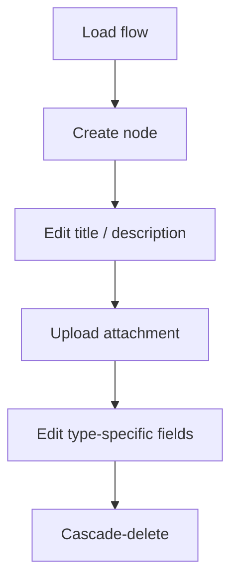

# Flow Chart Builder

A canvas-based editor for building messaging/automation flows: drag out a tree of nodes (triggers, messages, comments, business-hours branches), edit each one in a details drawer, and have every change persisted automatically. Built with Vue 3, Vue Flow, Pinia, Vue Router and TanStack Query, deployed on Vercel with Serverless Functions, Upstash Redis (flow data) and Vercel Blob (attachments).

See [ROADMAP.md](ROADMAP.md) for the full milestone history and the original scope decisions.

## Features

### Requirements

| Requirement | Where |
|---|---|
| Canvas of nodes, each showing an icon, title and truncated description | [FlowNodeRenderer.vue](src/components/nodes/FlowNodeRenderer.vue) |
| Create a node (title, description, type, parent) | "Create New Node" → [CreateNodeForm.vue](src/components/toolbar/CreateNodeForm.vue) |
| Update a node's title and description in a details drawer | [NodeDrawer.vue](src/components/nodes/NodeDrawer.vue), [NodeDetailsPanel.vue](src/components/nodes/NodeDetailsPanel.vue) |
| Send Message: message text and attachments | [SendMessageFields.vue](src/components/forms/SendMessageFields.vue) |
| Add Comment: comment text | [AddCommentFields.vue](src/components/forms/AddCommentFields.vue) |
| Business Hours: timezone and per-day time ranges | [BusinessHoursFields.vue](src/components/forms/BusinessHoursFields.vue) |
| Details drawer reachable by a URL containing the node ID | `/node/:nodeId` ([router](src/router/index.ts), [useNodeDrawer](src/composables/useNodeDrawer.ts)) |
| TanStack Query for fetching and mutations on the JSON payload | [useFlowQuery](src/composables/useFlowQuery.ts) (`useQuery`), [useFlowStore](src/stores/useFlowStore.ts) (`useMutation`) |
| Vue Router and Pinia | [src/router](src/router/index.ts), [src/stores](src/stores/useFlowStore.ts) |
| Deployed on Vercel | Frontend plus [api/](api/) Serverless Functions |

### Validation and rules

- **Deleting a node** also deletes every node downstream of it, after a confirmation.
- **Form validation:**
  - Title is required, up to 100 characters.
  - Description is optional; it, the message text and the comment are each capped at 1,000 characters.
  - Each business-hours row needs a start and end time, with the start before the end, and may not overlap an earlier row on the same day. Back-to-back ranges (09:00–12:00, 12:00–17:00) are allowed.
  - Attachments must be PNG, JPEG, GIF, WebP, SVG or PDF, up to 10 MB each. The browser checks this before uploading, and the upload endpoint enforces the same rules ([nodeFormValidation.ts](src/utils/nodeFormValidation.ts)).

### Nice-to-haves

- **Undo / redo** for every change (edits, creates, deletes, moves, auto-align): toolbar buttons, or `Ctrl/⌘+Z` to undo and `Ctrl/⌘+Shift+Z` or `Ctrl+Y` to redo. Shortcuts are ignored while typing in a field, so text undo still works there.
- **Keyboard navigation** on the canvas:
  - `Tab` moves between nodes and the "+" buttons; the canvas pans to whatever gets focus if it's off-screen.
  - `Enter` or `Space` on a node opens its drawer and moves focus into it.
  - `Escape` closes the drawer and returns focus to the node.
  - Arrow keys move the selected node; the move is saved and undo-able.
- **CI**: GitHub Actions runs lint, typecheck, unit tests, build and the Playwright end-to-end tests (see [CI](#ci)).

### Extras

- **Auto-align** re-lays out the whole tree; nodes can also be dragged, and positions are saved.
- **Quick add**: a "+" on every connection inserts a node there, and a "+" below every last node appends one.
- **Resizable drawer**, which becomes full-screen on narrow screens.
- **Works without the API**: if the flow can't be loaded, the app falls back to the bundled sample flow (see [Setup](#setup)).

## Setup

Requires [pnpm](https://pnpm.io/).

```bash
pnpm install
```

No `.env.local` needed. In local dev the app calls the deployed API. If that API can't be reached, the app still runs: it loads the bundled sample flow and shows a banner saying changes won't be saved.

To run the API locally instead, set `VITE_API_BASE_URL` in `.env.local` and provide Redis (`KV_REST_API_URL`/`KV_REST_API_TOKEN`) and Blob (`BLOB_READ_WRITE_TOKEN`) credentials — see [Running the project](#running-the-project).

## How it works

1. **Data model.** A flow is a flat array of nodes (`FlowNode[]`, [src/types/flow.ts](src/types/flow.ts)). There is no separate edge list — each node points at its parent via `parentId`, and the canvas tree (and its Vue Flow edges) is derived from that relationship on every render ([src/utils/flowGraph.ts](src/utils/flowGraph.ts)). The root node has `parentId: -1`. Five node types exist: `trigger` (flow entry, display-only), `sendMessage`, `addComment`, `dateTime` (business hours, branches into two `dateTimeConnector` children for `success`/`failure`), and `dateTimeConnector` itself (display-only).

2. **Canvas.** [CanvasView.vue](src/views/CanvasView.vue) renders the tree with [Vue Flow](https://vueflow.dev/). Node positions are stored on each node: a flow without them gets one auto-layout pass on load ([src/utils/flowLayout.ts](src/utils/flowLayout.ts) walks the tree depth-first and lays out each node under its parent), and after that drags and new nodes save their own positions. **Auto-align** reruns the layout and saves fresh positions for every node. Quick-add affordances (a `+` on every edge midpoint, a `+` after every leaf) let you insert or append a node besides the "Create New Node" button.

3. **State.** [useFlowStore](src/stores/useFlowStore.ts) (Pinia, setup-store style) is the single source of truth for `nodes`. All mutations act on it synchronously. Structural ones (`createNode`, `deleteNode`, `moveNodes`, `autoAlign`) then call `persist()` themselves; the drawer's field edits (`updateNode`, `updateBusinessHours`, `updateSendMessagePayload`, `updateComment`) are applied together and persisted once when "Save changes" is clicked. `persist()` records an undo step and saves the whole flow through a TanStack Query mutation (see Persistence). The store derives `vueFlowNodes`/`vueFlowEdges`/`addNodePlaceholders` as computed properties, so the canvas is always a pure function of `nodes`.

4. **Editing.** Clicking an interactive node opens [NodeDrawer.vue](src/components/nodes/NodeDrawer.vue), which renders a per-type fields component (`SendMessageFields`, `AddCommentFields`, `BusinessHoursFields`) alongside the shared title/description editor and delete action. The drawer is driven by the URL: opening a node navigates to `/node/:nodeId`, and loading that URL directly (a shared link, a refresh, Back/Forward) opens the canvas with that node's drawer. A link to a node that doesn't exist, or to one with no details (trigger, connector), closes the drawer with a toast.

5. **Persistence.** TanStack Query handles both fetching and saving. [useFlowQuery](src/composables/useFlowQuery.ts) fetches the flow (`useQuery(['flow'])`) and seeds the store from the first load; every save goes through a `useMutation` in the store that POSTs the flow and writes the saved copy back into the `['flow']` cache. Both use one shared [QueryClient](src/lib/queryClient.ts); both `/` and `/node/:nodeId` render `CanvasView`, so a direct load of a node URL fetches the flow the same way before opening the drawer. `GET/POST /api/flow?key=` ([api/flow.ts](api/flow.ts)) reads/writes the flow as a single JSON value in Upstash Redis, seeding it from [api/_fixtures/mockFlow.ts](api/_fixtures/mockFlow.ts) on first read if the key doesn't exist yet. Attachment uploads go through `POST /api/upload` ([api/upload.ts](api/upload.ts)), which issues a Vercel Blob client-upload token rather than proxying the file through the function body.

## Design decisions

1. **Edges are implicit, derived from `parentId`.** 
   Keeping a flat node array with a parent pointer (rather than a separate nodes+edges graph) means there's one place mutations happen and nothing to keep in sync; the canvas tree, the parent-picker dropdown, and cascade-delete all walk the same structure.

2. **Positions are stored, computed only on demand.** 
   Each node persists its own `position`, so manual drags survive reloads. The tree layout (`flowLayout.ts`) only runs to backfill nodes missing a position on load, and when the user clicks Auto-align, which overwrites every position. New nodes are placed under their parent, and inserting one pushes the target's subtree down to make room.

3. **Query owns the server copy; Pinia owns the working copy.** 
   TanStack Query holds what the server has: `useQuery(['flow'])` loads it and a single save `useMutation` writes it back, updating the `['flow']` cache on success. The Pinia store holds the editable working copy plus its undo history, so edits apply instantly (optimistic, no rollback) and a failed save shows a toast rather than reverting the canvas. The store seeds from the query once, on first load; after that the working copy leads, and re-seeding on every cache update would wipe undo history and could overwrite edits made while a save was in flight. One mutation saving the whole flow, rather than one per action (create/update/delete), matches the API, which only accepts the full flow.

4. **Saves run in order, not raced.** 
   The save mutation has a Query `scope`, so Query runs saves one at a time in call order, and each sends a snapshot of the flow taken when it was made. A rapid second edit can't have its request land before (and get overwritten by) a slower first one.

5. **Cascade delete.** 
   Deleting a node removes it and every downstream descendant (including whole `dateTime` success/failure subtrees). This was chosen over "delete just this node and re-parent its children" because a flow node's children are only meaningful in that node's context (e.g. a business-hours branch doesn't make sense reattached elsewhere).

6. **`trigger` / `dateTimeConnector` are display-only.** 
   They're real, positioned canvas nodes (so the tree has a visible root and visible branches) but intentionally not clickable and have no drawer — editing them wasn't in scope, and making them inert avoids a half-built edit UI for a node type with almost no editable data.

7. **Per-type field components over composables.** 
   I originally planned `useAttachments()`/`useComments()`/`useBusinessHours()` composables; these became full components (`SendMessageFields.vue`, etc.) instead, since each one owns both state and a non-trivial template, which a composable would just end up re-exposing to a wrapper component anyway.

8. **Full IANA timezone list, precomputed.** 
   The timezone combobox lists every zone from `Intl.supportedValuesOf('timeZone')` (~418), labeled with its UTC offset and sorted west-to-east. Offsets are generated offline into [src/data/timezoneOptions.json](src/data/timezoneOptions.json) because building ~400 `Intl.DateTimeFormat` instances at runtime blocked the main thread for seconds; typeahead search keeps the long list navigable.

9. **Flow data lives in Upstash Redis; uploaded files live in Vercel Blob.** 
   Flow data started out in Blob too, but every overwrite took ~1–1.5s (a full file rewrite plus CDN cache purge) and reads right after a write could return stale or broken content. A single Redis key per flow (one JSON value per deployment/test-key, in the same region as the functions) makes saves take milliseconds and reads immediately consistent. Blob is still the right fit for attachments: write-once static files served from a CDN.

10. **Client-upload token endpoint instead of a server-side proxy.** 
    `/api/upload` hands the browser a signed Blob upload token rather than streaming the file through the serverless function body, sidestepping the platform's request-body size limit entirely.

11. **`description` added to the schema as optional.** 
    The original sample payload had no description field; it was added to satisfy a title+description+type requirement per node, kept optional (not required) so empty-description rendering stays exercised, not just the populated case.

12. **The URL is the source of truth for the open drawer.** 
    `useNodeDrawer` has no `selectedNodeId` state of its own; it derives it from `route.params.nodeId`, and opening/closing the drawer is just navigation. Keeping one copy of the state means the URL and the drawer can't drift apart, and refresh, sharing a link and Back/Forward all work without extra code. `/` and `/node/:nodeId` render the same `CanvasView`, so switching between them keeps the canvas mounted (no re-fetch, no lost pan/zoom).

13. **Fall back to the sample flow when the API is unreachable.** 
    If loading the flow fails (after one retry, or a 10s timeout), the store loads the bundled [mockFlow](api/_fixtures/mockFlow.ts), the same payload the API seeds new flows from, instead of leaving an error screen. The app is fully usable in that mode, including undo, but saves are skipped rather than attempted: a banner says changes won't be saved, so there's no failed-save toast on every edit. This keeps the app reviewable even if the deployed API, Redis or the network is down. Attachment uploads still need the API.

## Project structure

```
src/
  components/
    nodes/         # node renderer, drawer, details panel
    forms/         # per-type field editors, shared field error/counter line
    toolbar/       # create-node modal/form, parent-picker tree select
    edges/         # custom quick-add edge
    ui/            # shadcn-vue primitives (button, dialog, select, ...)
  composables/     # useFlowQuery, useNodeDrawer, useCreateNodeModal, useToast
  stores/          # useFlowStore (Pinia)
  utils/           # flowGraph (tree/edges), flowLayout (positions), validation, ids
  api/             # fetchFlow/saveFlow/uploadAttachment (client-side fetch wrappers)
  views/           # CanvasView (renders both / and /node/:nodeId)
  router/          # route table
api/               # Vercel Serverless Functions: /api/flow, /api/upload
e2e/               # Playwright config helpers + golden-path spec
```

## Running the project

```bash
pnpm dev        # vite dev server, http://localhost:5173
```

This uses the deployed API (and its live database) via `VITE_API_BASE_URL` — see [Setup](#setup).

To run the API locally instead, use `vercel dev` and set `VITE_API_BASE_URL=http://localhost:3000`. You'll need Redis and Blob credentials (`vercel env pull .env.local`); without them, the app loads sample data and can't save.

Other scripts:

```bash
pnpm build       # vue-tsc -b && vite build
pnpm preview     # preview the production build
pnpm lint        # eslint .
pnpm format      # prettier --write .
pnpm typecheck   # vue-tsc --noEmit
```

## Running tests

**Unit/component tests** (Vitest + `@vue/test-utils`, co-located as `*.spec.ts` next to the source file):

```bash
pnpm test
```

**End-to-end tests** (Playwright, [e2e/golden-path.spec.ts](e2e/golden-path.spec.ts)): drives the full flow against a dedicated test flow key (`TEST_FLOW_KEY`, separate from the real flow data) and asserts against both the UI and the persisted JSON.



```bash
pnpm test:e2e
```

This spawns its own `vite` dev server on a fixed port with `VITE_FLOW_KEY` pointed at the test key, and reads `VITE_API_BASE_URL` from `.env.local` (Playwright's Node process doesn't get Vite's automatic env loading, so [e2e/env.ts](e2e/env.ts) parses the same file manually). You'll need a working `VITE_API_BASE_URL` for this to pass, for the same reason `pnpm dev` does.

Before finalizing any change, run all three gates:

```bash
pnpm lint && pnpm typecheck && pnpm test
```

## CI

[.github/workflows/ci.yml](.github/workflows/ci.yml) runs on every pull request and push to `master`:

- **`checks`** — `pnpm lint`, `pnpm typecheck`, `pnpm test`, `pnpm build`
- **`e2e`** — `pnpm test:e2e` (after `checks` passes), with `VITE_API_BASE_URL` pointed at the deployed instance. Runs are serialized across branches because they all reset and mutate the same shared test flow key. On failure, the Playwright report and traces are uploaded as a `playwright-report` artifact.

Deploys are handled separately by Vercel's Git integration. CI doesn't verify `api/` function behaviour — e2e exercises the frontend against the already-deployed API.
